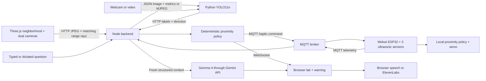

# 00 — Architecture and scope

The source conversation's readable user messages described glasses with sensors, a camera, obstacle detection, Gemma 4 answers, servo tapping and a 3D demonstration. Assistant messages were available only as content references, so this implementation does not claim to reproduce their unseen code or tool choices. Project name: OpenPilot Glasses (a working name derived from the conversation).

## Responsibility boundaries

- **ESP32:** read three range sensors, emit metres and operate the servo locally.
- **Three.js:** render a walkable Kenney neighborhood in overview and first-person views, raycast range geometry and upload synchronized JPEG/pose/metric bundles. It substitutes for distance hardware in local demo mode.
- **YOLO11n:** recognize camera objects with confidence and horizontal image location. Detection does not measure depth.
- **Node/Express:** orchestrate sources, reject malformed data, expire stale observations, expose APIs and relay MQTT.
- **Gemma 4:** answer natural-language questions grounded in the current snapshot. It does not control servo thresholds.
- **Voice:** browser speech by default; ElevenLabs is an optional server-side adapter.

## Timing and authority

The simulator sends readings every 200 ms, the server broadcasts every 100 ms, and readings expire after 2.5 seconds of server time. The camera worker is bounded by inference time and publishes at most five times per second. Distances below 0.7 m are danger, below 1.5 m are warning. Pulse periods are 180/600 ms. API/network latency does not delay the local ESP32 threshold decision, though connection attempts and sensor reads in this demo firmware are briefly blocking. This is not a hard real-time controller.

Only the selected distance producer (`simulator` or `wokwi`) contributes to the distance policy. Rendered camera frames retain their matching simulator metrics even when Wokwi is selected. Detection labels remain separate from range measurements. Simulated detections expire by their originating image capture time as well as receipt time. Sensor policy uses backend arrival times; retained MQTT messages are ignored. No uncalibrated association between a camera label and a range ray is made.

## Credits and scope choices

Use Gemma for the challenge's meaningful AI role, ElevenLabs if desired for polished speech, and optionally Render for the Node application. DigitalOcean can host a broker/backend if your team already has an instance. Backboard, Browserbase, Paper Instruments and Tinker are not required for this pipeline. Avoid adding services solely to consume credits. No fine-tuning is needed for the working baseline.

**Checkpoint:** the team can explain which component measures distance, which recognizes labels and which answers questions.
