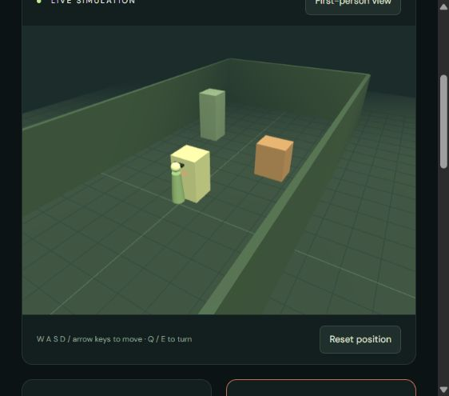

# Verification — 24 October 2026

Completed in the development workspace:

- `npm install`: installed the Node dependencies and generated `package-lock.json`; audit reported zero vulnerabilities at installation time.
- `npm test`: all 9 tests passed, including the local telemetry/WebSocket/demo-answer flow, synchronized image/metric transport, collision handling and expiry.
- `npm run check`: backend and frontend JavaScript syntax checks passed.
- Parsed `vision/detect.py` with Python's AST parser and `firmware/wokwi/diagram.json` with its JSON parser successfully.
- Opened the lab in a browser, selected Close obstacle, observed 0.40 m center and the danger warning, submitted a question and observed a clearly labeled scripted response grounded in that reading.
- Inspected the rendered 3D scene and saved `docs/images/lab-preview.png`.
- Initialized local Git with branch `main`; `.env` and installed dependencies are ignored.

Environment Studio upgrade verified:

- Loaded local Kenney models and the referenced palette texture, inspected the colored neighborhood and simultaneous first-person panel.
- Observed camera publication around 5 Hz after batching static geometry and caching shadow maps.
- Held the walking key in the browser: position changed from (5.70, 14.00) to (5.70, 11.76), stopping at the crate; center range changed from 2.50 m to about 0.26 m and triggered danger.
- Used the standard-library consumer to save three consecutive frame/metric pairs from the running browser. Decoded a JPEG with Pillow: 640×360, valid color image with nonconstant pixels.
- Camera routes, matching frame IDs, image byte transport and malformed/out-of-order rejection are covered by the pipeline and frame tests.
- Opened the live MJPEG endpoint and verified its multipart JPEG header; live camera and sensor frame IDs matched in `/api/observation`.
- Saved updated screenshots as `docs/images/environment-studio.png` and `docs/images/camera-and-sensors.png`.

Live MQTT upgrade verified:

- Connected to the actual HiveMQ public broker at `broker.hivemq.com:1883`.
- An independent subscriber received 8 non-retained messages spanning simulator telemetry, observations, camera frames and haptic commands.
- Confirmed the camera payload contained 22,567 JPEG bytes and shared the frame ID of the corresponding sensor observation.
- All 9 automated tests and JavaScript syntax checks still passed after integrating the MQTT bridge.

Not verified in this workspace: Arduino compilation, a running Wokwi project, a physical ESP32/servo, webcam inference/model download, real Gemma credentials and quota, ElevenLabs playback, microphone dictation, Docker build, or remote hosting. Source code and setup guides are included for these integrations; they are not represented as tested external services.

